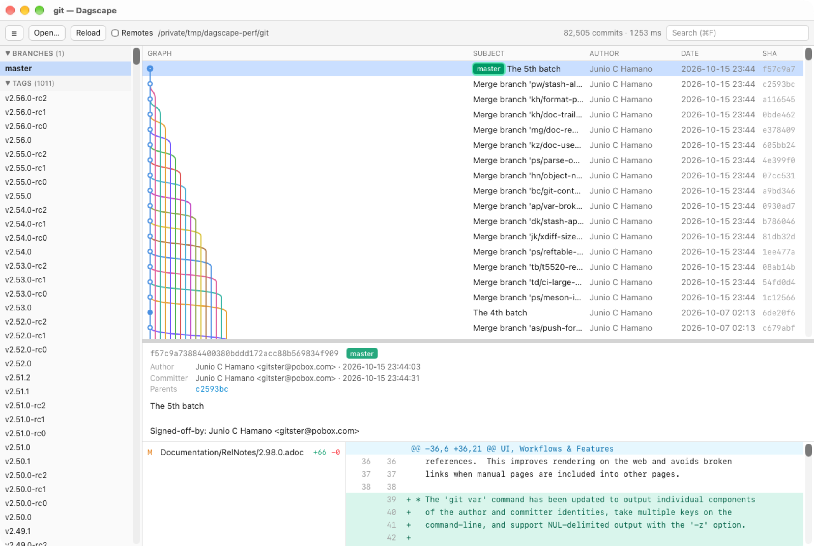

# Dagscape

A branch graph browser for Git. Shows the whole repository, every branch and tag at once,
as a lane graph you can scroll through, in the spirit of GitX. Built with Tauri 2, Svelte 5 and
libgit2, so it runs natively on Apple Silicon (and Windows).



## Features

- Every ref (local branches, remote branches, tags, HEAD) is in the graph by default. Remote
  branches can be hidden with one switch.
- Lanes are laid out in Rust and only the visible rows are drawn on a Canvas, so repositories
  with 100k+ commits scroll smoothly.
- Commit details: message, author / committer, parents (click to jump), changed files with
  +/- counts, unified diff per file. Renames are detected.
- Sidebar with branches, remotes and tags; click to jump to that commit.
- Search by subject, author, hash prefix or ref name, with Enter / Shift+Enter to step through hits.
- Reloads automatically when `.git/HEAD`, `packed-refs` or anything under `refs/` changes.
- Open a repository from the menu (⌘O), by dropping a folder onto the window, from the recent
  list, or from the command line: `dagscape /path/to/repo`.

## Command line (macOS)

Choose **Dagscape → Install Command Line Tools…** to put a `dagscape` command in
`/usr/local/bin` (a symlink to the app; it asks for an administrator password when the
directory is not writable). Install it again after moving the app.

```bash
dagscape              # open the repository that contains the current directory
dagscape ~/src/repo   # open another repository
dagscape --license    # print the licenses of Dagscape and the libraries it bundles
```

Each call opens a new window, because a Dagscape process shows one repository.

## Keyboard

| Key | Action |
|---|---|
| ⌘O | Open repository |
| ⌘R | Reload |
| ⌘F | Search |
| ↑ / ↓, j / k | Select previous / next commit |
| PageUp / PageDown, Home / End | Move through the list |
| Enter / Shift+Enter (in search) | Next / previous hit |
| Esc (in search) | Clear search |

## Install

```bash
brew install --cask cyberneura/tap/dagscape
```

Or download the dmg from [Releases](https://github.com/cyberneura/dagscape/releases).

## Development

```bash
pnpm install
pnpm tauri dev          # run the app with hot reload
pnpm check              # svelte-check
cd src-tauri && cargo test
pnpm tauri build        # release bundle
pnpm notices            # regenerate THIRD-PARTY-NOTICES.txt
```

## Release

`pnpm release [patch|minor|major]` bumps the version in `src-tauri/tauri.conf.json` and
`package.json`, commits and pushes to `main`. The GitHub Actions workflow builds a signed and
notarized universal dmg for macOS and an NSIS installer for Windows and publishes the Release.

## License

MIT. See [LICENSE](LICENSE).

## Third-party licenses

[THIRD-PARTY-NOTICES.txt](THIRD-PARTY-NOTICES.txt) lists the libraries bundled into the app
(JavaScript packages, Rust crates and the native libraries they ship, such as libgit2) with their
license texts. In the app, open it from **Dagscape → Third-Party Licenses** on macOS or
**Help → Third-Party Licenses** on Windows, or run `dagscape --license`.

Regenerate it with `pnpm notices` after adding or upgrading a dependency. It needs
[cargo-about](https://github.com/EmbarkStudios/cargo-about) at the version pinned in
`scripts/generate-third-party-notices.sh`.
